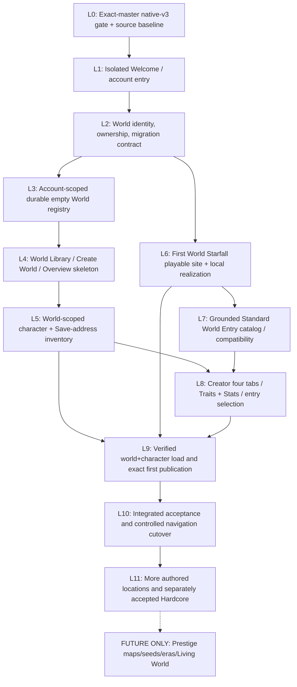

# First World Launcher, Character Entry, and World Loading: Gated Implementation Process Map

Date: 2026-11-11  
Status: **implementation planning, not active authorization**  
First executable segment: [L1 Welcome / Account Gate Implementation Plan](first-world-launcher-l1-welcome-account-entry-implementation-plan-2026-11-11.md)  
Product contract: [Welcome, World Library, Character Entry and World Loading](welcome-world-library-character-entry-and-loading-plan-2026-11-11.md)  
Design dispositions: [Launcher, World and Character Intent Audit](launcher-world-character-design-intent-audit-2026-11-11.md)  
Decision ledger: [Issue #74](https://github.com/vagabond1215/Lineage_Reforged/issues/74)

> **Hard owner constraints:** One developer-authored First World at launch. Player worlds are durable instances of that authored geography, **not player-edited terrain** and not Save-slot skins. Existing native-v3 account and campaign/Save owners remain authoritative. The [prior Codex local-entry prompt](../dev/current-codex-prompt.md) is marked **completed**, and the [L0 local-entry handoff](../dev/first-world-launcher-l0-local-entry-handoff-2026-11-11.md) accepts only that external baseline. This process map is **not** L1 implementation authorization; `HOLD_SELECTED_ATOMIC_ACTIVATION` and `HOLD_STAGING_PUBLICATION` remain. Multi-map expansions, world seed UX, templates, historical deformation, time skips and Living World concurrency stay WIP / Coming Soon until individually authorized.

## 0. Scope, initial truth and orchestration rules

### 0.1 Current source verified (2026-11-11)

- `apps/rpg-ui/src/EpochApp.tsx` boots through `CleanEpochLauncherRead.bootstrap()`, recovers accepted pending epoch operations, then displays `ACCOUNT_ACCESS` or `MAIN_MENU`; signed-in `MAIN_MENU` Continue currently resolves the latest Save slot. It has no independent World Library state.
- `game-shell/state.ts` declares `ACCOUNT_ACCESS`, `MAIN_MENU`, `CHARACTER_CREATION`, `LOAD_GAME`, `SETTINGS`, and `IN_GAME`; `MainMenuScreen.tsx` mixes account/meta and Save-slot surfaces.
- `LocalAccountAccessScreen.tsx` already owns local form input behavior (account picker/create/password/stay signed in, backup and account-management affordances). `CleanEpochAccountAdapter.ts` owns verified sign-in, registration, selected-session hint and lifecycle validation; `CleanEpochLauncherRead.ts` owns account-scoped async inventory/load; `cleanEpochAccountStore.ts` owns retained IndexedDB epoch records.
- The world is represented by an authored `world_map.first_world` and existing regions/localities/hexes/routes/settlements/ecology. **No accepted separately persisted world-instance registry, exact local spawn geometry/instance owner or complete World Entry catalog** has been verified. Current eight Core entry ideas are editorial only; Myridian has no current dedicated spawn profile.
- Current creator retains an eight-step legacy flow, `startingBundleId`, Review, and nonpublishing randomization. The owner-selected four-tab/no-Review/atomic Surprise Me variant is not implemented.
- The earlier [Full Access readiness record](../dev/native-v3-full-access-environment-readiness-2026-11-11.md) was blocked at process registration, but that failure was resolved in a later local run. [Version-specific exact-master browser evidence](../dev/native-v3-exact-master-version-selection-accepted-2026-11-11.md) and the [focused L0 handoff](../dev/first-world-launcher-l0-local-entry-handoff-2026-11-11.md) now establish **L0_ACCEPTED_LOCAL_ENTRY_BASELINE**. Recheck current source and all remaining segment entry conditions before executing L1; no hosted/default activation is implied.

### 0.2 Global rules for every implementation segment

**Entry template (must be recorded before edits):**
1. Fetch `origin/master`, record exact commit SHA, branch/worktree state, known open active prompt/holds, relevant code contracts and any preexisting test failures. Preserve unrelated work and user Saves.
2. Record prior segment's accepted evidence and every remaining blocker. If prerequisite is missing, produce a **named HOLD with source/test evidence**, do not fake missing owner data or widen scope.
3. Identify files intentionally in scope; create a narrow, isolated branch/working cut as approved, without modifying `docs/dev/current-codex-prompt.md` or consuming currently active task resources.
4. Establish positive, negative, failure-injection and Save/restart tests **before** cutover; label projections versus durable mutations. Choose an actual branch-specific build/browser environment, no blind production deploy.
5. Keep an explicit rollback/fallback for newly introduced UI while old supported journey remains readable and without data writes.

**Exit template (the segment is not accepted merely because code compiles):**
1. Complete promised behavior with source/tracing and correct ownership; verify field/identity/Save invariants.
2. Run focused unit/contract/negative/integration tests plus required typecheck/build and **exact-source selected browser proof** for user-facing sections. Store command, pass counts, source head, environment and observable steps. If browser blocked, classify `CODE_READY_BROWSER_HELD`, not `ACCEPTED`.
3. Inspect changed-file list, obsolete references and data invariants; clean **only provably dead code/docs within scope**. Update stale/superseded design pointers without deleting historical evidence or widening runtime schema.
4. Commit, read back exact authoritative source, record result and next segment inputs. Never claim deployment, v3 activation, Save migration or Game version increase without separate accepted authority.

**Uniform statuses:** `NOT_STARTED` → `ENTRY_CHECK` → `READY` → `IMPLEMENTING` → `CODE_READY_BROWSER_HELD` or `FAILED_BLOCKED` or `ACCEPTED`. Any contract breach is `STOP_HOLD`; the next stage consumes **ACCEPTED** only. `DEFERRED_WIP` is not a passing status. Failed stage may be retried from retained exact attempt or reverted presentation; no automatic reroll/Save overwrite.

## 1. Dependency process map



The diagram is a **dependency DAG**, not a mandate to execute independent branches concurrently. No two branches may concurrently mutate the same native-v3 Save/account/source owner. L6 and L3 may be designed independently; final wiring is held until one compatible world and Save contract exists.

## 2. Stage-by-stage entry, exit, success and failure table

| Stage | Exact **entry gate** | Bounded implementation/output | **Exit and success evidence** | **Failure/STOP_HOLD** / next |
| --- | --- | --- | --- | --- |
| **L0: Baseline & environment** | Current active prompt + exact source, no unreviewed conflicting owner work | Resolve registered Vite and direct+browser ordinary-entry gate on **exact master** under current installed task, record tests and source; no UX edits | Direct HTTP + controlled browser observe registered Vite; native-v3 ordinary dev `/`, compiled-preview split as installed; clean scoped cleanup/readback; explicit accepted handoff | Registered-launch/browser/read failure → `ENVIRONMENT_READINESS_BLOCKED` or `EXACT_MASTER_BROWSER_HELD`; do not start L1 |
| **L1: Welcome auth surface** | **L0 ACCEPTED**; current clean account owner source verified | New branded signed-out / signed-in Welcome surface; retained account auth, session validation; guarded World Library handoff behind disabled-by-default feature path; no world Save mutation | Persistent session shows named Welcome; signed out form works; Continue targets guarded Worlds boundary in test-only path; logout clears session only; old launcher unchanged when feature off; selected browser+keyboard/mobile proof | Auth bypass, lost sign-in feature, cross-account display, Continue loads Save, storage error shows empty worlds, any Save mutation → hold/revert isolated UI; next L2 |
| **L2: World identity and migration contract** | L1 accepted, current account/Save format read owners known | Distinguish account/world-instance/map/character/campaign/continuity/slot; pin single First World content manifest; choose store ownership/version and old-campaign association policy **before schema writes** | Reviewed typed contract, lifecycle/revision/error tables, empty world independence, two-account isolation, one-world dedicated clock posture, migration alternatives and tests approved | Treating `campaign.worldState` or Save-slot label as shared world owner; unplanned Save breaking change; no migration → block L3 |
| **L3: Durable world registry** | L2 contract accepted; approved schema epoch/store plan and retention safeguards | Add transactional world create/list/read/associate + stable creation intent/revision/readback; one authored blueprint; no character required | Create one empty world, restart, list same ID; duplicate create/retry returns same world; stale account/world CAS blocked; no account leak; missing vs corrupted vs inaccessible distinguished; archival/backup policy verified | Double creation, unversioned localStorage index, false empty on I/O error, overwrite/corruption, orphaned account → hold L4 |
| **L4: World Library, setup and overview frame** | L3 accepted, truthful world-index read API | Activate visibly distinct WORLD LIBRARY (not Save); empty state, Create World small form, select and World Overview; future content disabled | Continue → World Library; create uses idempotent registry; repeat/relogin shows same world; no character auto-generated; failures have distinct UI; signed-in/out back paths and responsive proof | World cards derived by slot guessing, player terrain editor, fake seed/Prestige purchase, default world on failed read → hold L5 |
| **L5: World-scoped character registry/addresses** | L3/4 accepted; campaign/Save identity and migration/association contract selected | Project real characters, terminal history, existing valid slots inside selected world, eligible Bloodlines; explicit address-to-world binding; ambiguity checks | Same account can see only verified selected-world characters; ready/prepared/pending/corrupt/closed remain distinct; existing characters not lost or automatically cloned; Load candidate readback proven | Cross-world disclosure, Save history loss, 1 slot = 1 world assumption, fake offspring/duplication → stop; next L9 read path |
| **L6: Local First World area and deterministic realization** | L2 map/content/version tie accepted; Starfall source IDs and true instance owner scoped | One **developer-authored** Starfall local walkable area, real shore/safe buffer/exits and persistent area identity; one resource and later approved spawn/provider patches | Real coordinates/paths/terrain, never through water or objects; same manifest/internal seed yields same creation; Save/restart restores accepted entities, no duplicate food/loot/monster; geography joins validated | Macro pixel treated as walkable tile, nonexistent NPC/plant/wreck, no safe path or inconsistent seed → no scene promotion |
| **L7: Standard Core entry resolver and scenes** | L6 real site and interactions; Backstory eligibility owners audited | Typed scenario eligibility for **Standard Core**, Backstory × site × scene, owner-grounded initial actions; diversity target 2 ungated, >=3 preferred | At least two materially distinct supported scenes for admitted start context, no Local/Farmhand automatic Core, manual selector and random eligible pool agree, no invented items/actors | Any authored label treated as executable, nonexistent room/charity/ship, only one compatible scene without declared exception → hold L8/9 |
| **L8: Character creator revision** | L5 world context and L7 scenario eligibility; approved trait/stat owner budget and source bindings | Four tabs, immutable heir/founder context, Backstory, Traits+Attributes, Identity, Location+Entry; no Review/kit shopping, Start Journey and whole-character Surprise Me | Exact nine-stat/resource preview parity, legal trait credit, scenario preservation/revalidation, direct manual entry, legal atomic Surprise Me, no improper Core estates, existing draft changes preserved | New loose form localStorage authority, unapproved trait bonuses, invalid heir, random reroll on retry, false success → hold L9 |
| **L9: World loading + first publication** | L3/5/6/7/8 accepted; native-v3 publisher/recovery owner and source head verified | Read world/character/head, recover original attempts, verify exact area; publish new character into world via one authoritative native-v3 path; scenario starts pending | Restart resumes same world, clock, position, items/claims and scenario; exact creation intent once; recover failed Save without new character, repeat reward or overwriting later campaign; action paths are real | World regenerated on Load, copied histories, head CAS miss, orphaned character, duplicated items/Prestige, missing site → STOP with recoverable artifact |
| **L10: Integrated release/cutover gate** | L1-L9 accepted; current active native-v3 and publication holds separately reviewed | End-to-end Welcome → World → Character → Spawn → actions → Save/restart tests, no forced old user-data reset, UI accessibility + route cleanup | Independent exact-build/browser evidence with synthetic accounts, account switch, world creation, character start/return, crash/retry; approved rollout and rollback; current Save formats readable per migration | Any remaining hold means **no staged/hosted production activation**; preserve old launcher or a safe maintenance path |
| **L11: Wider authored coverage and Hardcore (separate)** | L10 or specific owner-authorized parallel source, real Hardcore survival/permadeath owner | More actual starting cities/biomes/encounters/routes and isolated Hardcore site; content authoring and QA | Each eligible Backstory/mode/location has more than one honest entry; Hardcore remains isolated and terminal death final under real stakes rules | No hardcore world-site/path/permadeath owner → `DEFERRED_WIP`, no cosmetic fake toggle |
| **FUTURE: optional variation** | A separately selected Prestige/pack/time/generation owner | Multiple maps, underworld, reproducible seed templates, later world eras/Living World | Distinct new implementation roadmap/acceptance | Disabled/Coming Soon, cannot debit Prestige, cannot alter current First World |

**Milestone mapping to prior plan:** existing W0-W8 UX workpackages are refined, not discarded. L0~W0; L1~W1; L2-L3~W2 architecture; L4~W3; L5 and L9~W3/W6; L6~W4; L7-L8~W5; L9~W6; L10~W7; L11~W8. L0 is an *external prerequisite*: it is now accepted **only** by the separately documented [2026-11-11 local-entry handoff](../dev/first-world-launcher-l0-local-entry-handoff-2026-11-11.md), never merely by checking in this plan. L1 source implementation still requires its own preflight and authorization.

## 3. Cross-stage state and identity constraints

```text
Account [verified credential/lifecycle/revision]
  └─ World Instance [new independent ID, First World blueprint/content manifest, clock/head owner]
       ├─ World-area instances [stable canonical site + area template + placed entities]
       └─ Character/continuity [actual source lineage and current playable/terminal posture]
            └─ Campaign/Save address [slot address -> exact artifact/head, owners/recovery]
                 └─ Pending or progressed World Entry [scenario version + receipts]
```

- `worldInstanceId` must not equal `worldMapId`, character ID, campaign ID, Save slot or map pixel.
- An **empty world** can exist before any character, and a saved character is not the world registry.
- **Individual World only** initially: one dedicated world timeline per supported active continuity. Any later shared Living World requires a *single* clock/head and participant coordinator; do not fork a mutable world across independent Saves.
- World creation does not run character creation; selecting a character does not create worlds; world Load does not reroll ecology, terrain or NPCs.
- New generation must be idempotent and preserve content/generator versions, accepted materializations and depletion.
- A new UI cannot upgrade a descriptive guild to an active NPC/station, or a macro biome to local gatherable node.
- Standard Core vs Hardcore Core are distinct story pools and spawn conditions; player-facing difficulty/world/Stakes axes remain distinct.
- Old native-v3 data must not be implicitly converted by a read-only world browsing/listing action.

## 4. Failure taxonomy and required incident evidence

| Failure | Required user-visible outcome | Technical posture |
| --- | --- | --- |
| Auth invalid credentials | Stay on signed-out Welcome, explicit error; no side effects | Reject, no world/slot read |
| Session hint stale/malformed or account unavailable | Warning with recovery/relogin instructions as permitted, NOT “no worlds” | Block; account owner stays truth |
| World registry write partially accepted | Recover original `creationIntentId` and read back; never duplicate | Pending/recoverable receipt, no second ID |
| Stale account/world/head revision | State changed; refresh review/selection | CAS failure, no mutation |
| Missing/incompatible authored content | Unplayable world/entry with precise missing source | Preserve stored identities and Save |
| Existing Save marked prepared/pending/corrupt/terminal | Distinct blocked/inspect/recover actions only | No load by label alone |
| Character World Entry incompatible | Show which Backstory/mode/site/actor/action conflicts | Do not auto-substitute or publish |
| Area geometry/route/resource validation fails | Block scene/world start, preserve chosen draft | No fabricated starting object |
| First publication consumer interrupted | Resume original retained attempt, source and head | No second character, reward or heir consumption |
| Browser environment cannot retain registered Vite | Report exact launch failure with source/environment and scoped cleanup | No selected/browser acceptance or activation claim |
| Known old tests fail before change | Record exact baseline and compare only targeted deltas | Cannot claim “all tests pass”; no unrelated broad cleanup |
| Game/Save deployment not independently authorized | Stay on local/test path | No Site, branch/PR, version or gameplay activation |

For every failure capture: exact source commit, relevant authority/revision IDs (with account secrets redacted), stage, trigger, input fingerprint where applicable, observed vs expected, whether any durable write committed, recovery path and tests. Never log plaintext passwords, unrestricted raw Save payloads or identifiable user account data.

## 5. Segment closeout and cleanup policy

**During segment:** minimize changed files and preserve current source owners. Do not implement broad migrations with a UI-only change. Keep historical design docs intact but put a single clear supersession note/index pointer where stale instructions would mislead.

**At acceptance:** compare old/new route and test results, remove unused *new* scaffolding, debug fixtures and duplicate UI state only where source references/tests prove they are dead. Do not delete legacy login, slot loader, `launcherAuthManager`, former world metadata or player history until independent consumers are inventoried and a migration/deletion acceptance is recorded. Remove only exact task-owned temp servers/processes/HTML exports after capturing evidence.

**Handoff artifact for every segment** (place in dedicated dated implementation/evidence record, not a blind append to active Codex prompt):

```text
Stage / exact source ref / active external holds / entry proof
Changed paths + owner / decisions / user-visible behavior / feature flag
Positive + negative + retry/readback/browser tests and observed results
Known baseline failures / failures triggered / recoverability and data safety
Docs supersession notices/old code cleanup performed or deferred + rationale
Precise next-stage dependencies, unresolved owner/schema choices and trigger
Git commit/PR status, rollout posture and rollback plan (no implied deployment)
```

**No invented run results:** This map was written from remote source review. No build, browser run, native-v3 consumer operation, staged activation or production source change was performed by this documentation pass.
